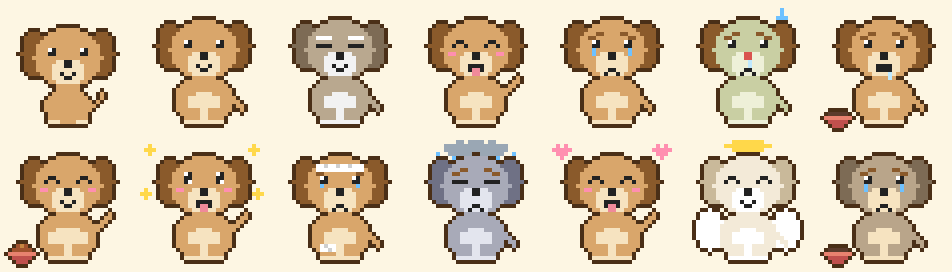

# 🐶 tamagotchi-game

강아지 다마고치를 키우는 턴제 선택형 게임임. (프로그래밍 기초 조별과제)

## 실행 방법

Python 3.10 이상 필요. 별도로 설치할 패키지는 없음. (tkinter는 Python에 기본 포함)

```bash
python main.py        # 게임 실행 (Mac/리눅스는 python3, 윈도우는 py)
python test_logic.py  # 게임 규칙 자동 테스트 (화면 없이 2000판 플레이)
```

## 구현 요소

| 요소 | 내용 | 코드 위치 |
| --- | --- | --- |
| 스테이터스 바 | 건강 / 행복 / 친밀도 (0~10, ■□ 막대) | `main.py` → `draw_stat_bars()` |
| 상태창 | 배부름·감기 등 키워드 상태, 마우스를 올리면 효과·남은 턴 표시 | `data.py` → `STATUSES`, `main.py` → `show_tooltip()` |
| 선택지 | 매 턴 무작위 선택지 + 나이 고정 / 상태 조건 / 계절 선택지 | `data.py` → `CHOICES`, `game_logic.py` → `pick_next_choice()` |
| 나이 / 계절 | 선택할 때마다 계절이 바뀌고, 한 바퀴 돌면 1살 | `game_logic.py` → `advance_season()` |
| 다마고치 | 도트 그래픽 강아지 이미지 14장, 상황에 맞게 자동 교체 | `images/`, `game_logic.py` → `pet_image_name()` |
| 엔딩 | 스테이터스 0 / 잘못된 선택 / 자연사(7살~) / 10살 도달, 선택 기록 돌아보기 | `data.py` → `ENDINGS` |

---

## 강아지 이미지 (도트 그래픽)



위 순서대로 `puppy` `normal` `senior` `happy` `sad` `sick` `hungry` / `full` `excited` `injured` `depressed` `ending_good` `ending_angel` `ending_lonely` 순서임.
(32x32 도트를 5배 확대한 160x160 PNG)

게임은 상황에 따라 아래 규칙으로 이미지를 선택함. (위에 있는 조건이 우선)

| 조건 | 이미지 |
| --- | --- |
| 엔딩이 남 | `ending_good`(좋은 엔딩) / `ending_angel`(떠남) / `ending_lonely`(가출·소원해짐) |
| 상태 `부상` / `감기` / `우울` | `injured` / `sick` / `depressed` |
| 상태 `배고픔` / `신남` / `배부름` | `hungry` / `excited` / `full` |
| 건강 3 이하 | `sick` |
| 행복 3 이하 / 7 이상 | `sad` / `happy` |
| 아무 일 없음 | 0~1살 `puppy`, 2~6살 `normal`, 7살 이상 `senior` |

## 파일 구성

```
data.py          게임 "내용" (선택지, 상태, 엔딩 글, 이미지 목록)   ← 내용을 바꿀 땐 여기만!
game_logic.py    게임 "규칙" (턴 진행, 계절, 엔딩 판정, 이미지 고르기)
main.py          "화면" (tkinter로 그리기, 버튼)
test_logic.py    자동 테스트
images/          강아지 도트 이미지 (PNG)
tools/make_images.py   이미지를 만드는 도구 (게임 실행에는 필요 없음)
```

### 코드 읽는 순서

1. `data.py` : 딕셔너리와 리스트로만 구성됨. 게임 내용을 먼저 훑어보는 단계임.
2. `game_logic.py` : `choose()` 함수가 한 턴의 흐름이 담겨 있음. 위에서 아래로 번호(1~6) 순서대로 읽음.
3. `main.py` : 맨 아래 "화면 배치" 부분 → 위의 `refresh()` 순서로 읽음.

### 코드를 쉽게 만든 방법 (읽는 사람을 위한 설명)

- **클래스 미사용.** 함수 + 딕셔너리(`game`)만 사용함. 게임의 현재 상태는 `game` 딕셔너리 하나에 모두 저장됨.
- **람다(`lambda`), 컴프리헨션, 타입 힌트 미사용.** `for`, `if`, 함수, 딕셔너리, 리스트만 사용함.
- **강아지는 이미지 파일(PNG)** 로 표시하며, 사용할 이미지는 `pet_image_name()` 한 함수에서 `if`문으로만 결정함.
- **버튼은 3개로 고정**하고 선택지 개수만큼만 표시함. 버튼마다 함수(`click_1`, `click_2`, `click_3`)가 별도로 존재함.
- **내용(data.py)과 규칙(game_logic.py)과 화면(main.py)을 분리**하여 선택지 추가 시 화면 코드를 수정할 필요가 없음.
- 모든 파일에 한국어 주석을 작성함.

---

## 코드 수정하는 방법

### 1. 선택지 추가하기 (가장 많이 하게 될 작업)

`data.py`의 `CHOICES` 리스트 안에 아래 모양을 복사하여 추가함. **쉼표(`,`) 누락 주의.**

```python
    {
        "id": "my_choice",                      # 이름표 (다른 선택지와 겹치면 안 됨)
        "prompt": "다마고치가 비 오는 창밖을 보고 있다.",   # 화면에 나오는 상황 설명
        "options": [                            # 선택지 답변 (1~3개)
            {"text": "우산 쓰고 산책한다",
             "stats": {"happiness": 1, "health": -1},   # 스테이터스 변화
             "add": {"감기": 3},                         # 상태 추가 (상태이름: 지속 턴)
             "result": "신나게 놀았지만 비를 맞았다."},   # 선택 후 나오는 문장
            {"text": "집에서 쉰다",
             "stats": {"intimacy": 1},
             "result": "창밖을 같이 구경했다."},
        ],
    },
```

등장 조건이 필요하면 선택지에 아래 항목을 **추가로** 넣음.

| 항목 | 의미 | 예시 |
| --- | --- | --- |
| `"seasons"` | 이 계절에만 등장 | `"seasons": ["여름", "가을"],` |
| `"requires"` | 이 상태가 있을 때만 등장 | `"requires": ["감기"],` |
| `"forbids"` | 이 상태가 있으면 등장 안 함 | `"forbids": ["배부름"],` |
| `"min_age"` | 이 나이 이상일 때만 등장 | `"min_age": 7,` |
| `"fixed_age"` | 이 나이가 되면 반드시 한 번 등장 | `"fixed_age": 4,` |

답변에서 쓸 수 있는 효과:

| 항목 | 의미 | 예시 |
| --- | --- | --- |
| `"stats"` | 스테이터스 증감 (`health` 건강, `happiness` 행복, `intimacy` 친밀도) | `{"health": 1}` |
| `"add"` | 상태 추가 (이미 있으면 남은 턴을 덮어씀) | `{"감기": 3}` |
| `"remove"` | 상태 제거 | `["감기"]` |
| `"ending"` | 이 답변을 고르면 바로 엔딩 | `"ending": "poison"` |

### 2. 상태 추가하기

`data.py`의 `STATUSES` 안에 추가함.

```python
    "졸림": {
        "per_turn": {"happiness": -1},      # 매 턴 행복 -1 (효과가 없으면 {} )
        "flavor": "눈이 자꾸 감긴다.",       # 마우스 오버 시 나오는 설명
    },
```

이후 선택지에서 `"add": {"졸림": 2}` 형태로 사용함.

### 3. 엔딩 추가하기

`data.py`의 `ENDINGS` 안에 추가한 뒤 선택지의 `"ending": "키이름"` 으로 연결함.

```python
    "my_ending": {
        "title": "엔딩 제목",
        "text": "엔딩 문장",
        "good": True,        # True면 ★, False면 ☆
    },
```

### 4. 숫자(난이도) 바꾸기

| 바꾸고 싶은 것 | 위치 |
| --- | --- |
| 시작 스테이터스 | `data.py` → `INITIAL_STATS` |
| 게임이 끝나는 나이 | `data.py` → `MAX_AGE` |
| 자연사 확률 / 시작 나이 | `game_logic.py` → `advance_season()` |
| 10살 엔딩 조건 | `game_logic.py` → `final_ending()` |
| 글꼴 / 창 크기 | `main.py` 맨 위 `FONT...`, `root.geometry(...)` |
| 화면 색깔 | `main.py` 맨 위 `BG_COLOR` 등. `"brown"`, `"wheat"`처럼 **색 이름**으로 지정함 ([색 이름 목록](https://www.tcl.tk/man/tcl8.6/TkCmd/colors.htm)) |

### 5. 이미지 바꾸기 / 추가하기

**이미지 한 장 바꾸기** : `images/` 폴더에 같은 이름(예: `happy.png`)으로 덮어씀. 크기는 **160x160 PNG**로 맞춰야 함. (테스트에서 크기를 검사함)

**새 이미지 추가하기** (예: 졸린 모습 `sleepy`)

1. `images/sleepy.png` 파일을 넣음.
2. `data.py`의 `IMAGE_NAMES` 목록에 `"sleepy"`를 추가함.
3. `game_logic.py`의 `pet_image_name()` 함수에 조건을 한 줄 추가함.

```python
    if "졸림" in statuses:
        return "sleepy"
```

**이미지를 코드로 다시 만들기** : `python tools/make_images.py`를 실행하면 `images/`의 PNG가 모두 다시 생성됨. `tools/make_images.py`의 `SPECS`에 표정 설명(눈, 입, 꼬리, 장식)을 한 줄 추가하면 새 이미지 생성 가능함. (⚠️ 직접 그려서 덮어쓴 이미지는 다시 실행하면 원래 이미지로 복구됨)

### 6. 수정 후 테스트 진행

```bash
python test_logic.py
```

`data.py`에 오타가 있으면(없는 상태 이름, 선택지 id 중복, 답변 4개 이상 등) 테스트에서 오류 위치를 알려줌. 통과 후 `python main.py`로 실제 화면도 확인함.

### 7. 자주 발생하는 오류

| 오류 | 원인 |
| --- | --- |
| `SyntaxError` | 쉼표(`,`), 따옴표(`"`), 괄호 빼먹음 |
| `KeyError: '...'` | 없는 상태 이름 / 스테이터스 이름 오타 (`happiness`, `health`, `intimacy`만 가능) |
| `IndexError` | 답변을 4개 이상 넣음 (버튼이 3개) |
| `_tkinter.TclError: couldn't open "...png"` | 이미지 파일이 없거나 `IMAGE_NAMES`의 이름과 파일 이름이 다름 |
| 한글이 깨져 보임 | 글꼴이 없는 컴퓨터 → `main.py` 맨 위 `"Malgun Gothic"`을 다른 글꼴로 변경 |

---

## 팀원과 같이 작업하는 방법 (Git)

```bash
git pull                        # 1. 작업 시작 전에 최신 코드 받기
# ... 코드 수정 ...
python test_logic.py            # 2. 테스트
git add .                       # 3. 변경한 파일 담기
git commit -m "겨울 선택지 2개 추가"   # 4. 무엇을 했는지 적어서 저장
git push                        # 5. GitHub에 올리기
```

팀원끼리 **같은 파일의 같은 부분**을 동시에 수정하면 충돌이 발생함. 선택지는 `data.py`의 서로 다른 위치에 추가하거나 작업 범위를 미리 나눠야 함.
